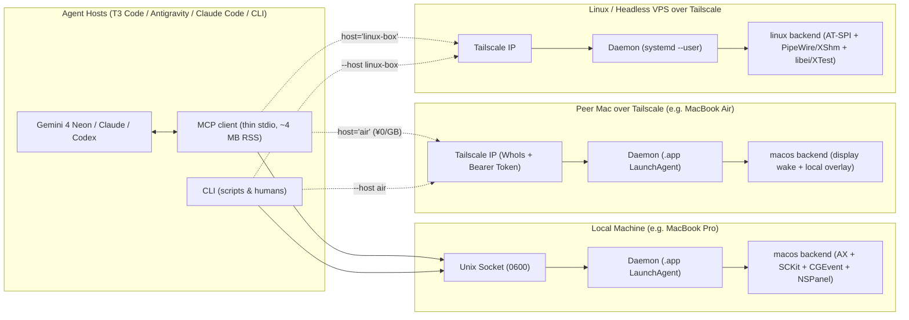
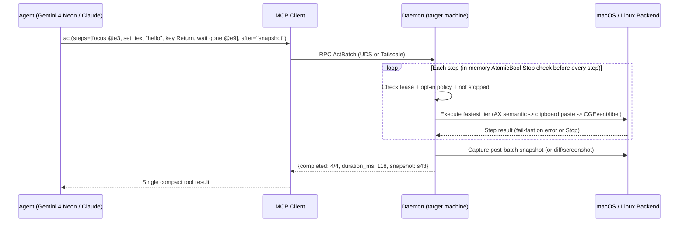

# `agent-desktop` — Rust Computer-Use System Design

> [!NOTE]
> Repo: **`agent-desktop`**, daemon: **`desktopd`**, client/MCP binary: **`desktop`**, crates: `desktop-proto`, `desktop-core`, `desktop-macos`, `desktop-linux`, `desktop-daemon`, `desktop`. Designed to completely replace legacy pixel-only desktop MCP servers across macOS and Linux machines for maximum speed, low token usage, background operation, and full owner control.

---

## 1. Goals & Why Replace Legacy Pixel-Only Desktop MCPs

Legacy single-process pixel-click MCP servers proved local macOS clicking works, but have structural bottlenecks that hold back fast multi-machine agent workflows:

| Bottleneck today | Root cause | Target in the Rust system |
| --- | --- | --- |
| **Slow actions (~100–500 ms each)** | Spawns a fresh Swift `helper` process per call (twice per click: `scene` + `click`), cold-inits `SCShareableContent`, writes JPEG to disk, reads back in Bun | Persistent per-machine daemon over Unix domain socket; in-process AX/CG/SCKit, zero disk I/O for frames (**<15 ms** input, **<50–90 ms** capture/snapshot) |
| **High token cost & fragile clicking** | Pixel-only: every turn sends a 1568 px JPEG (~1,000–1,600 vision tokens) and asks the model to guess `(x, y)` | **Hybrid Accessibility-tree-first + Vision fallback**: compact semantic `@eN` refs (~300–800 text tokens), exact targeting, optional Set-of-Marks annotated screenshots (`annotate: true`), window-scoped & region-cropped capture |
| **Chatty 1-action-per-LLM-turn loops** | No batching or event waits; filling a form + submitting + checking result takes 4–6 LLM turns | **Atomic batched `act` pipelines** (`focus -> set_text -> key -> wait_until -> snapshot`) executed inside the daemon in **1 LLM turn** |
| **Slow long text entry (~2 s for 3k chars)** | 16 UTF-16 char `CGEvent` chunks with 10 ms sleeps | Fastest tiered entry: `AXSetValue` (<5 ms) → save/restore clipboard paste (~150 ms settle for async Chromium/Electron paste reads, arbitrarily large text) → raw `CGEvent` for tiny ASCII or opt-in typing |
| **Disruptive cursor hijacking** | Always moves the physical cursor via `CGEvent` | Semantic `AXPress` / `AXSetValue` executes without moving the pointer (and often without raising the window) when supported |
| **Single local Mac only** | Stdio-only Bun process per session, macOS-only, PID lockfile | Fleet-aware: local UDS + **Tailscale-only peer RPC** (`host: "mac-a" | "mac-b" | "linux-box"`), plus `PlatformBackend` for Linux (Wayland/X11/headless) |
| **Unwanted built-in app blocks** | Hardcoded `SENSITIVE_APPS` / `DIALOG_APPS` refusals and modal dialogs get in the owner's way | **Owner-responsible default (`open`)**: no hardcoded app blocks or forced dialogs; optional opt-in rules in `policy.toml` + instant physical Esc/Stop override |
| **Fragile PID lock & orphan cleanup** | `session.json` PID file + `ps` polling | Connection-bound lease in daemon: UDS/HTTP disconnect immediately frees the lease & hides the indicator |

### Scope Boundary
- Keep `preview_*` / Playwright / `headless-browser` when pure web DOM automation is faster, and `device_*` / `agent-device` for iOS/Android simulators.
- This tool owns **all OS desktop use cases**: native macOS/Linux apps, cross-app workflows, system UI/dialogs, terminals/editors when desired, Electron/legacy/custom-canvas GUIs, and unattended remote/headless desktops across your machines.

---

## 2. System Architecture

### 2.1 Topology: One Daemon per Machine, Thin Client Anywhere



### 2.2 Workspace & Crate Boundaries

Following your existing Rust workspace conventions (Edition 2024, resolver 3, crate-local deps, `#![forbid(unsafe_code)]` everywhere except platform FFI crates):

```text
<repo>/
├── Cargo.toml                  # workspace manifest (edition = "2024", resolver = "3")
├── crates/
│   ├── <prefix>-proto/         # Wire types, RPC messages, UI tree schema, validation, errors
│   │                           #   (#![forbid(unsafe_code)], zero platform deps)
│   ├── <prefix>-core/          # Session lease, opt-in policy engine, batch runner,
│   │                           #   wait engine, audit log, Clock trait, PlatformBackend trait
│   │                           #   (#![forbid(unsafe_code)], 100% unit-testable with mock backend)
│   ├── <prefix>-macos/         # macOS backend: objc2 (SCKit, CGEvent, AXUIElement, AppKit, IOKit)
│   │                           #   Main-thread NSApplication loop, Stop NSPanel, display wake
│   ├── <prefix>-linux/         # Linux backend: atspi, ashpd (RemoteDesktop/ScreenCast),
│   │                           #   reis (libei), x11rb (XShm/XTest), headless compositor launcher
│   ├── <prefix>-daemon/        # Daemon server: UDS + Tailscale HTTP/2 JSON-RPC transport,
│   │                           #   peer UID / Tailscale WhoIs + token auth, lifecycle
│   └── <bin>/                  # Unified binary: `<bin> mcp` (rmcp stdio) + CLI + `<bin> daemon`
├── packaging/
│   ├── macos/                  # setup-signing.sh, build-app.sh, Info.plist, LaunchAgent plist
│   └── linux/                  # systemd --user service, headless Xvfb/Wayland wrapper
└── docs/
    ├── DESIGN.md
    └── API.md
```

---

## 3. Core Interaction Model: Hybrid UI-Tree + Vision + Batches

### 3.1 The Fast Perception Ladder

Agents choose the cheapest perception level that answers their question:

1. **`list_windows` (<10 ms, ~100 tokens)** — Displays + visible windows (`window_id`, app name, bundle ID, title, bounds, focused, minimized, occluded). Zero pixel capture.
2. **`snapshot` (30–80 ms, ~300–800 text tokens)** — Structured Accessibility tree of the focused window (or a specified `window_id` / `app`), pruned to interactive + informative nodes (splicing decorative/same-title wrappers and redundant child text leaves, omitting per-element bounds and implied/noisy actions by default; pass `include_bounds: true` when geometry is needed) with short refs `@e1..@eN`:
   ```text
   snapshot_id: s42 · app: Notes (com.apple.Notes) · window: w108 "Project Ideas" [100,80 900x700]
   @e1 toolbar
    @e2 button "New Note"
    @e3 textfield "Search"
   @e4 list "Notes List"
    @e5 row "Architecture Notes" selected actions=[press]
   @e7 textarea "Note Body" focused value="Drafting..."
   ```
   - **Live handle binding**: Each `@eN` holds a live backend handle (`AXUIElement` / AT-SPI object) + attribute fingerprint + bounding rect. If layout shifted slightly, the daemon resolves the live coordinates or reports a stale-ref error instead of misclicking.
   - **Hard traversal budgets**: Default max depth `12`, max emitted nodes `250`, hard wall-clock budget `150 ms`, per-element AX timeout `500 ms`. Returns `truncated: true` + `subtree_ref` hints so the agent can drill down (`snapshot(root_ref: "@e4")`) without stalling on huge DOMs.
   - **Auto-enabling Electron/Chromium AX**: On macOS, automatically sets `AXManualAccessibility = true` on Chromium/Electron apps so browsers, VS Code, T3 Code, Slack, and Discord expose rich AX trees immediately.
3. **`screenshot` (40–90 ms, multimodal image)** — For visual inspection, layout/CSS checks, charts, canvas/custom-drawn apps, or sparse AX trees:
   - **Scope**: `window` (default when `window_id` or `app` is given — sharper, smaller), `display`, or `region: {x, y, w, h}` crop at native 1:1 Retina resolution.
   - **Adaptive sizing**: Caps full-display captures to 1568 px long edge / 1.15 MP for vision models; preserves full detail on window/region crops.
   - **In-memory encoding**: Hardware-accelerated ImageIO JPEG/WebP (PNG opt-in for pixel-exact diffs) — zero temp-file round-trip.
   - **Set-of-Marks (`annotate: true`)**: Draws crisp numbered `@eN` overlays directly on the frame buffer synchronized with the exact `snapshot_id`, letting vision models combine pixels with exact `@eN` targeting.
   - **Unchanged short-circuit (`if_changed_since: "s41"`)**: Fast perceptual/frame hash; returns `{unchanged: true}` with zero image tokens when nothing moved.
4. **`read_text` / `find`** — Direct AX text/selection/clipboard reads and server-side AX search (`find(query: "Export", role: "button")`) without dumping whole trees into model context.

### 3.2 Atomic Action Batching (`act`) & Fastest Execution Tiers



**Fastest tiered execution inside `act`:**

| Step `op` | Target | Fastest execution strategy |
| --- | --- | --- |
| `click` | `ref` (`@e12`) **or** `{x, y}` | Default for plain left click on `ref`: **`AXPress`** (<5 ms, no cursor warp, works unfocused on native apps) → falls back to physical pointer click at live element center if unsupported or `mode: "pointer"` / right-click / modifiers / multi-click. |
| `hover` / `mouse_move` | `ref` or `{x, y}` | Moves pointer directly to live element center or pixel point. |
| `drag` | `from`, `to` | Smooth interpolated drag with mid-step `AtomicBool` Stop check. |
| `scroll` | `ref` or `{x, y}`, `direction`, `amount` | Line or pixel-smooth scrolling. |
| `set_text` | `ref` (optional; defaults to focused), `text`, `replace`, `submit` | **1. `AXSetValue`** (<5 ms, instant, unfocused-capable) when supported and replacing/empty.<br>**2. Tiny ASCII (`<= 16` chars)**: raw `CGEvent` keystrokes (~10 ms, zero clipboard touch).<br>**3. Longer / multiline / Unicode text**: **save `NSPasteboard` → write UTF-8 → `Cmd/Ctrl+V` → restore pasteboard** (~150 ms settle for async Chromium/Electron reads, arbitrarily large text!).<br>Explicit `method: "type"` override available for apps that intercept paste. |
| `key` | `combo`, `repeat` | Portable combos (`mod+c` maps to `cmd+c` on macOS, `ctrl+c` on Linux; explicit `cmd`/`ctrl` also supported). |
| `open_app` / `focus_window` | `app` or `window_id` | Launches/activates app or raises specific window. |
| `menu` | `app`, `path: ["File", "Export", "PDF..."]` | Direct AX menu-bar traversal + `AXPress` (~10 ms, no cascading menu animation). |
| `wait` | `until`: `exists` / `gone` / `text_contains` / `focused_app` / `window_title` / `visual_change`, `timeout_ms` | Event-driven via `AXObserver` / AT-SPI / fast 50 ms frame-diff poll (max 15 s). |
| `sleep` | `ms` (max 5000 ms) | Abortable settle delay. |

### 3.3 Background / Non-Disruptive Execution (`focus_mode`)

Every `snapshot`, `screenshot`, and `act` call supports `focus_mode`:

- **`"background"` (zero-disruption):** Never focuses the target app, never raises its window, and never warps the physical mouse cursor.
  - **Observe:** Uses `AXUIElement` traversal + `SCContentFilter(desktopIndependentWindow:)` — captures and inspects occluded/unfocused windows natively on the current Space (fails cleanly if minimized or on another inactive Space).
  - **Act:** Executes via semantic `AXPress` / `AXSetValue` / `AXConfirm` / `AXShowMenu` / AX menu-bar actions (and optional `CGEvent::post_to_pid` for simple native key events). If a step genuinely requires foreground HID input (e.g., custom canvas click, drag, or Electron view that ignores background events), returns a structured `requires_focus` error instead of interrupting your active window.
- **`"auto"` (default):** Always tries zero-focus background execution first (AX + `desktopIndependentWindow` capture); falls back to brief focus-and-restore (save frontmost app + cursor position → execute HID input → restore) only for steps that require real foreground events.
- **`"foreground"`:** Explicitly activates/raises the target window and uses standard HID events when desired.
- **Linux headless bonus:** On Linux headless sessions (`Xvfb` / headless Wayland), every window runs in its own isolated virtual display, so 100% of apps (including Chrome/Electron/canvas) run in the background with zero interference.

---

## 4. MCP & CLI Surface (12 Lean Tools)

Every tool accepts an optional `host` parameter (default `"local"`).

1. **`list_hosts`** — Local + configured Tailscale peers: reachability, OS, display/lock state (`unlocked` | `display_asleep` | `screen_locked`), TCC/permission health, active lease holder.
2. **`session_start`** (or alias `request_access`) — `(host?, reason?, apps?, wait_for_lease_ms?)` — Acquires the single-writer control lease on `host` (instant in default `open` mode; auto-wakes a sleeping unlocked display if needed; shows optional non-blocking Stop indicator). `apps` is optional (omit = all apps allowed).
3. **`session_end`** (or alias `release`) — `(host?)` — Releases the lease, drops display-wake assertion, hides Stop indicator.
4. **`list_windows`** — `(host?, app?, include_displays?)` — Fast window & display inventory.
5. **`snapshot`** — `(host?, app?, window_id?, root_ref?, max_depth?, max_nodes?, focus_mode?, include_bounds?)` — Compact pruned AX tree with `@eN` refs (element bounds omitted by default; pass `include_bounds: true` when needed).
6. **`find`** — `(host?, query, role?, app?, window_id?, limit?)` — Fast server-side AX search returning matching `@eN` refs.
7. **`screenshot`** — `(host?, target: {display | window_id | app | region}, annotate?, format?, if_changed_since?, focus_mode?)` — Fast in-memory capture with optional `@eN` Set-of-Marks overlay & unchanged short-circuit.
8. **`act`** — `(host?, steps[], after?: "none" | "snapshot" | "screenshot" | "annotated", expect_snapshot?, focus_mode?, release_after?)` — Atomic 1–25 step action batch with optional post-action perception and early lease release.
9. **`read_text`** — `(host?, ref? | window_id?, mode?: "value" | "selection" | "clipboard")` — Direct text/clipboard read.
10. **`menu`** — `(host?, app, path[])` — Direct native menu-bar invocation.
11. **`wait`** — `(host?, condition, timeout_ms?)` — Event-driven wait.
12. **`status`** — `(host?)` — Permissions, screen lock/display state, active lease, and daemon version.

*(Note: When an agent calls `snapshot`, `screenshot`, or `act` without calling `session_start` first in default `open` mode, the daemon can **auto-acquire** an implicit session lease bound to the MCP connection — saving yet another LLM round-trip! Explicit `session_start`/`session_end` remain available for scoped control or clean early handoff.)*

---

## 5. Control, Safety & Audit Model (Owner-First, Non-Blocking)

Per your preference, **the tool trusts the owner and never blocks you with hardcoded app refusals or forced approval popups**:

- **Default policy (`mode = "open"`):** Every app is controllable immediately with zero modal dialogs. No hardcoded `SENSITIVE_APPS` or `DIALOG_APPS` blocks, and no automatic window hiding in screenshots.
- **Opt-in guardrails (`~/.config/<bin>/policy.toml`):** If you ever want restrictions on a specific machine, you can optionally configure:
  - `mode = "open" | "confirm"` (default `"open"`)
  - `deny_apps = []` (optional user-chosen blocklist)
  - `confirm_apps = []` (optional user-chosen dialog list)
  - `redact_passwords = false` (optional `AXSecureTextField` masking; default `false` or `true` — your choice, easily toggled)
  - `overlay = true` (show subtle floating status + `Double-Esc or Stop` pill with clickable Stop button while an agent is actively driving the screen; set `false` for headless/quiet runners)
- **Physical Double-Esc / Stop kill-switch:** Even in `open` mode, pressing physical `Esc` twice within 450 ms while a control lease is active (distinguished from synthetic agent `Esc` via `MARK = 0x4453_4B54`, and ignored while idle or during standalone read-only observation) or clicking `Stop` (or running `<bin> stop`) immediately aborts the active batch/session via an in-process `AtomicBool`, releases the lease, records a short stop cooldown to block racing auto-reacquires, and returns a clear `stopped_by_user` error to that agent session so you always keep instant physical override without accidental single-Esc lockouts.
- **Connection-bound single-writer lease:** Only one agent drives a machine at a time (optional `wait_for_lease_ms` queue). If an agent crashes or disconnects, the daemon detects socket EOF and immediately frees the lease.
- **Clean audit log:** `~/.local/state/<bin>/events.jsonl` logs session start/end, caller host/agent, step counts, and stops (never logging typed text or clipboard contents).

---

## 6. Unattended, Clamshell & Locked Mac Behavior (Air + Pro Scenario)

> [!IMPORTANT]
> **Direct answer to "working on Pro while Air is locked and plugged in":**
> Because of how macOS WindowServer works, **a truly locked Mac (`loginwindow` active) cannot have its user desktop apps captured or driven** — macOS hides user windows behind the secure login screen, blocks `AXUIElement` on background user apps, and only lets ScreenCaptureKit see the lock screen.
> **However, a plugged-in Mac with its display off / dimmed / lid closed CAN run desktop agents 24/7** if configured cleanly.

### Exact macOS State Matrix

| Air State | ScreenCaptureKit | `CGEvent` Input | `AXUIElement` | Works for agents? |
| --- | --- | --- | --- | --- |
| **Unlocked, screen on** | Full | Full | Full | **Yes (native)** |
| **Unlocked, display asleep (timeout)** | Fails while asleep | Drops while asleep | Throttled | **Yes — daemon auto-wakes display** via `IOPMAssertionDeclareUserActivity` + holds `PreventUserIdleDisplaySleep` during lease |
| **Unlocked, lid closed (clamshell) + NO external/virtual display** | Fails (`-3815`, no framebuffer) | Fails / coordinate drift | Throttled | **No** (WindowServer tears down display) |
| **Unlocked, lid closed (clamshell) + Virtual Display or $5 dummy plug** | **Full** | **Full** | **Full** | **Yes — 100% reliable, physical panel off** |
| **Screen locked (`loginwindow` active)** | Lock screen only | Lock screen only | Blocked for user apps | **No** (macOS OS boundary) |

### Two Clean Ways to Make Your Pro → Air Workflow Work 24/7

1. **Setup A — Native Air Desktop (Recommended for your always-online Air runner):**
   - Keep the Air's session **unlocked** (disable *"Require password after screen saver begins or display is turned off"* on Air; keep FileVault enabled for reboot/theft protection, or use a dedicated macOS runner user).
   - Keep a **virtual display** active on the Air (via BetterDisplay virtual screen, a `CGVirtualDisplay` helper, or a tiny $5 USB-C/HDMI dummy plug) so the WindowServer framebuffer stays alive even with the lid closed or physical screen brightness at `0%`.
   - **Built into `<prefix>-macos`:** When a remote call arrives from Pro while Air's display has timed out, the daemon checks `CGSessionCopyCurrentDictionary`:
     - If **display asleep (unlocked)**: automatically fires `IOPMAssertionDeclareUserActivity` to wake the framebuffer and holds a `PreventUserIdleDisplaySleep` assertion for the duration of the active lease, then releases it when idle.
     - If **screen locked (`CGSSessionScreenIsLocked == true`)**: fails fast with structured error `screen_locked` (instead of hanging or blindly clicking the lock screen).
2. **Setup B — Host Air Locked + Headless macOS/Linux VM on Air:**
   - If you require the host Mac session to stay locked for physical security (e.g. in a shared space), run a lightweight headless guest VM on Apple Silicon (`Virtualization.framework` via `tart run --no-graphics`, or a Linux headless compositor on a VPS/VM).
   - Inside the guest VM, the desktop stays unlocked on its own virtual display and runs `<bin>d` over Tailscale, completely unaffected when the host Air is locked.

---

## 7. macOS Backend & Local Self-Signed TCC Stability (`<prefix>-macos`)

### 7.1 Threading & Crate Stack
- **Main thread (`NSApplication.run()`):** `ActivationPolicy::Accessory` (`LSUIElement = 1`), floating Stop `NSPanel`, global Esc `NSEvent` monitor, optional `NSAlert` dialog. Receives UI commands from Tokio via `dispatch2::Queue::main()`.
- **Tokio runtime threads:** UDS + Tailscale HTTP/2 server, lease/policy/batch engine, warm `ScreenCaptureKit` capture (`objc2-screen-capture-kit`), blocking worker pool for `AXUIElement` (`objc2-application-services`) + `CGEvent` (`objc2-core-graphics`) + `IOKit` power assertions.
- **No `osascript`, no subprocess spawning, no Swift compilation at runtime.**

### 7.2 Persistent TCC Without an Apple Developer Account

Raw ad-hoc signing (`codesign -s "-"`) changes the binary's `cdhash` on every `cargo build`, which causes macOS `tccd` to silently break Screen Recording and Accessibility grants after every rebuild.

**Clean local solution (`packaging/macos/setup-signing.sh` + `build-app.sh`):**
1. **One-time per Mac (`setup-signing.sh`):** Generates a local RSA/EC **Code Signing** certificate (e.g. `CN=AgentDesktop Local Signer`, extended key usage `codeSigning`), imports it into your login Keychain, and marks it trusted for Code Signing (`security add-trusted-cert` — one macOS Keychain password prompt, once ever).
2. **Every build (`build-app.sh`):**
   - Copies the release binary into `/Applications/<AppName>.app/Contents/MacOS/<bin>d` with a fixed `Info.plist` (`CFBundleIdentifier`, `LSUIElement = true`, `NSScreenCaptureUsageDescription`).
   - Signs the inner binary and outer `.app` bundle with that fixed local certificate and an explicit designated requirement pinned to the certificate's SHA-1/subject + bundle ID (`-r="designated => identifier \"...\" and certificate leaf = H\"<cert-sha1>\""`).
   - Installs/reloads `~/Library/LaunchAgents/<bundle-id>.plist` in `gui/$(id -u)`.
3. **Result:** You toggle Screen Recording + Accessibility ON **once** per Mac in System Settings; every subsequent `cargo build` + redeploy preserves both grants automatically.

---

## 8. Linux & Headless Backend (`<prefix>-linux`)

Behind the same `PlatformBackend` trait:

| Target | Screen Capture | Input Injection | UI Tree | App / Window Info |
| --- | --- | --- | --- | --- |
| **Headless Linux VPS / Container** | Managed `Xvfb` or headless Wayland (`cage` / `mutter --headless`) | `x11rb` (`XTest`) or `reis` (`libei`) | `atspi` (session D-Bus) | `_NET_WM_PID` / AT-SPI + `/proc/<pid>/exe` |
| **Interactive Wayland** (GNOME/KDE/COSMIC) | `ashpd` (`ScreenCast` portal) → PipeWire | `ashpd` (`RemoteDesktop` `ConnectToEIS`) → `reis` (`libei`) | `atspi` (D-Bus AT-SPI2) | Portal / AT-SPI app ID |
| **Interactive X11** | `x11rb` (`MIT-SHM`) | `x11rb` (`XTest`) | `atspi` | `_NET_WM_PID` + `WM_CLASS` |

---

## 9. Multi-Machine Fleet Transport (Tailscale)

- **Local (`host: "local"` or omitted):** Unix domain socket (`0600`), verified via `LOCAL_PEERCRED` / `SO_PEERCRED` (same UID). Zero network stack overhead.
- **Remote (`host: "mac-a" | "mac-b" | "linux-box"`):**
  - Private `~/.config/agent-desktop/fleet.toml` maps aliases to Tailscale hostnames/IPs (never committed to public repos).
  - Daemon binds **strictly** to the Tailscale interface IP (`100.x.y.z:<port>`), never `0.0.0.0`.
  - **Dual auth:** (1) Tailscale WireGuard IP + `tailscale whois` check confirming the peer belongs to your tailnet, plus (2) 256-bit bearer token stored `0600` (never committed to dotfiles).
  - **Binary frame transfer:** Screenshots stream as raw WebP/JPEG bytes over HTTP/2 rather than double-base64 JSON.
  - **Fast offline detection:** `list_hosts` uses a 500 ms connect timeout so a sleeping Mac reports `status: "offline"` cleanly.

---

## 10. Performance Budget

| Operation | Current `desktop.js` + `helper.swift` | Target Rust Daemon (Local UDS) | Target Rust Daemon (Tailscale LAN) |
| --- | --- | --- | --- |
| `list_windows` | N/A | **< 10 ms** | **< 20 ms** |
| `snapshot` (AX tree, 250 nodes) | N/A | **30–80 ms** | **45–100 ms** |
| `screenshot` (window WebP/JPEG) | ~250–500 ms (full display + disk) | **40–80 ms** | **70–130 ms** |
| Single `click` | ~100–180 ms (2 process spawns) | **< 15 ms** | **< 30 ms** |
| `set_text` (3,000 chars) | ~2,000 ms (chunked CGEvent) | **< 5 ms** (AX) / **~150 ms** (paste) | **< 175 ms** |
| 5-step form fill + submit + verify | 5 LLM turns + ~2.5 s tool time | **1 LLM turn** + ~120 ms tool time | **1 LLM turn** + ~180 ms |

---

## 11. All-Phase Roadmap & Verification

- **Phase 1 — Core + macOS Local (`proto`, `core`, `macos`, `daemon`, `cli+mcp`, packaging)**
  - Workspace scaffold, `PlatformBackend` trait, full `core` unit tests (injectable `Clock`, lease, batching, opt-in policy, AX pruning).
  - `macos` backend: `AXUIElement` snapshot/`find`/`menu`/`AXPress`/`AXSetValue`, Electron `AXManualAccessibility`, warm `ScreenCaptureKit` + ImageIO + `annotate: true` SoM, tiered `set_text` (AX → clipboard save/restore → `CGEvent`), `IOKit` display wake/keep-awake + lock detection, native `NSPanel` Stop overlay.
  - `setup-signing.sh` + `build-app.sh` + LaunchAgent + live integration check script + drop-in MCP config replacement for Gemini/Antigravity & Claude Code.
- **Phase 2 — Multi-Machine Fleet (Tailscale RPC)**
  - Tailscale-bound HTTP/2 listener, Tailscale WhoIs + bearer token auth, `~/.config/<bin>/hosts.toml`, `list_hosts`, binary screenshot transfer, Pro ↔ Air end-to-end verification.
- **Phase 3 — Linux & Headless Backend (`linux`)**
  - X11 (`x11rb` + `MIT-SHM` + `XTest`) + `atspi` + managed headless `Xvfb` session (for 24/7 VPS/container GUI), plus Wayland (`ashpd` + PipeWire + `reis` `libei`).
- **Phase 4 — Warm Streaming & Optimization**
  - Persistent low-FPS/on-demand `SCStream` frame ring buffer (sub-15 ms screenshot grabs & true visual-diff `wait`), performance benchmark suite vs `desktop.js`.

---

## 12. Repo & Binary Naming Candidates

Matching your `agent-board` (`board` / `board-proto` / `board-server`) convention:

| Repo Name | CLI / Daemon | Crates | Vibe / Notes |
| --- | --- | --- | --- |
| **`agent-desktop`** *(Recommended)* | `desktop` / `desktopd` | `desktop-proto`, `desktop-core`, `desktop-macos`, `desktop-linux`, `desktop-daemon`, `desktop` | Exact symmetry with `agent-board` (`board`); matches the existing `desktop` MCP server name cleanly. |
| **`agent-pilot`** | `pilot` / `pilotd` | `pilot-proto`, `pilot-core`, `pilot-macos`, `pilot-linux`, `pilot-daemon`, `pilot` | Short, memorable, conveys driving whole machines (not just one screen). |
| **`agent-cue`** | `cue` / `cued` | `cue-proto`, `cue-core`, `cue-macos`, `cue-linux`, `cue-daemon`, `cue` | Stands for *Computer Use Engine*; ultra-short 3-letter CLI. |
| **`agent-screen`** | `ascreen` / `ascreend` | `screen-proto`, ... | Clear, though `screen` collides with GNU `screen`. |
| **`agent-computer`** | `acomp` / `acompd` | `computer-proto`, ... | Literal, slightly clunky CLI abbreviation. |
